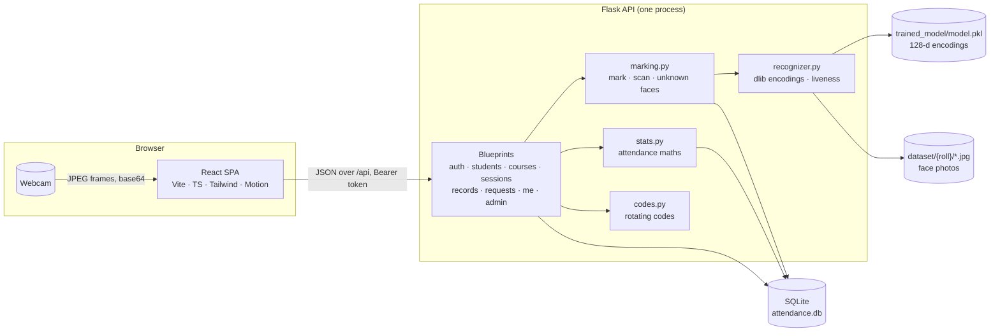
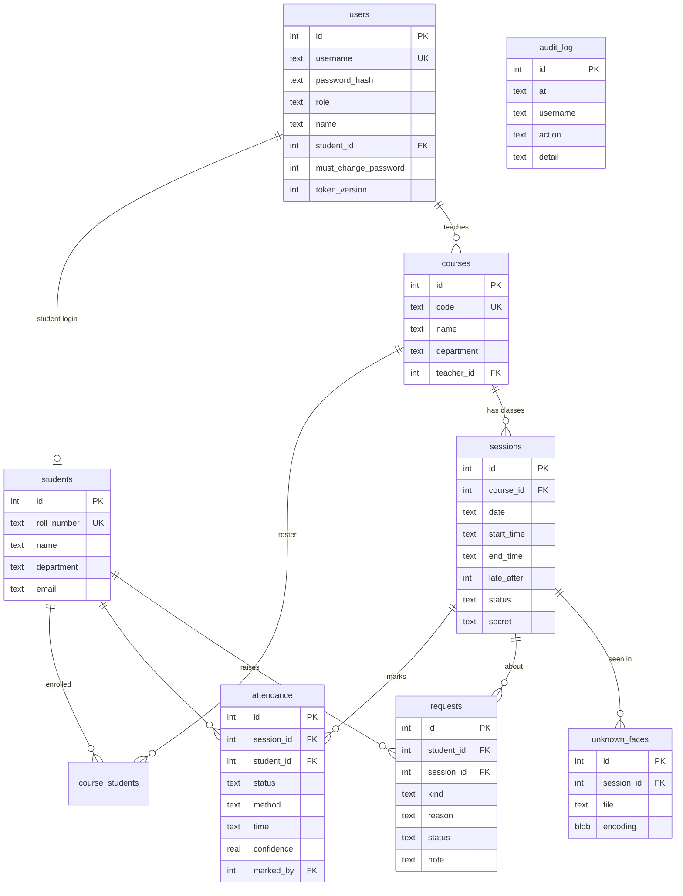
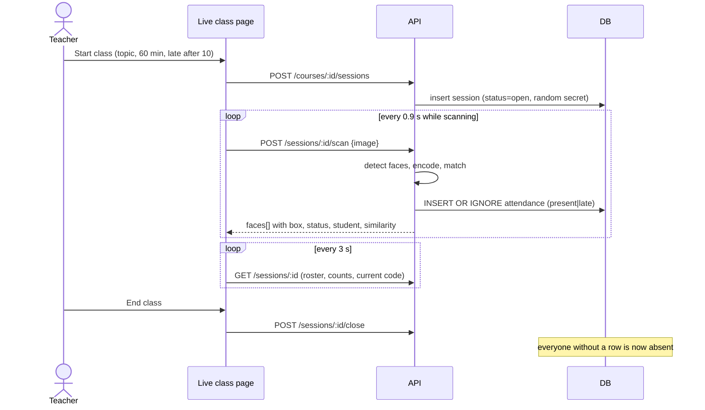
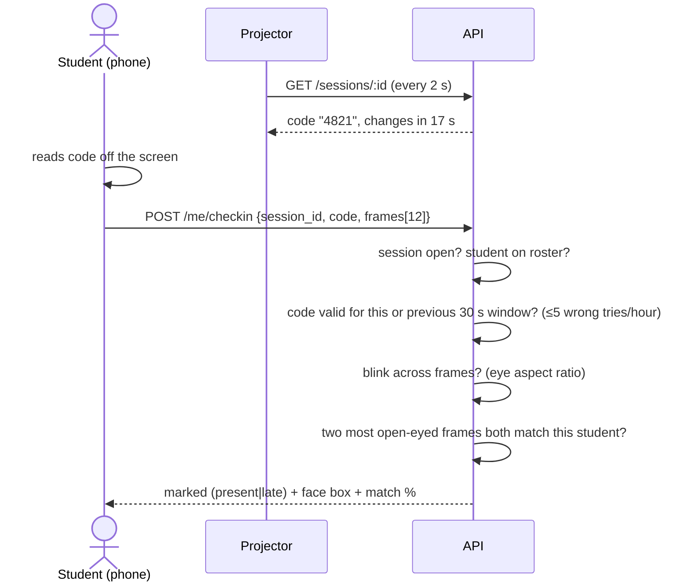

# Present! — How it all works

This document explains the whole system: what it does, how it's built, and why it's built that way. For setup and the feature list, see [README.md](README.md).

**Contents**

1. [The problem](#1-the-problem)
2. [Architecture](#2-architecture)
3. [Roles and permissions](#3-roles-and-permissions)
4. [Data model](#4-data-model)
5. [Attendance rules](#5-attendance-rules)
6. [Key flows](#6-key-flows)
7. [Face recognition](#7-face-recognition)
8. [Liveness: the blink test](#8-liveness-the-blink-test)
9. [Rotating classroom codes](#9-rotating-classroom-codes)
10. [Security](#10-security)
11. [Analytics](#11-analytics)
12. [Frontend](#12-frontend)
13. [API reference](#13-api-reference)
14. [Testing](#14-testing)
15. [Deployment and configuration](#15-deployment-and-configuration)
16. [Limitations and future work](#16-limitations-and-future-work)
17. [Presenting the project](#17-presenting-the-project)

---

## 1. The problem

Roll call wastes the first five to ten minutes of every lecture, and paper or "say present" registers are easy to cheat: a friend answers for you (a **proxy**). A face-recognition register is faster, but a naive one has its own holes:

| Naive approach | Hole | What Present! does |
|---|---|---|
| One attendance row per day | Can't tell lectures apart; a holiday becomes a "class day" if anyone checks in | **Courses → sessions**; attendance is per session |
| Students check in from their phone | They can do it from bed | Must type a **code that's only visible in the classroom** and changes every 30 s |
| Match a face in one frame | Hold up a photo of your friend | **Blink liveness** across a burst of frames |
| Only "present" exists | Late arrivals, medical leave and scanner misses are all treated the same | **present / late / excused / absent**, plus **leave and correction requests** |
| Anyone can edit the register | Nobody knows who changed what | **Roles**, scoped access and an **audit log** |

---

## 2. Architecture



- **One Flask process, one gunicorn worker, eight threads.** The face model (a list of 128-number vectors) lives in memory so matching is instant. A lock guards it, and enrollments update it in place. More workers would each hold their own copy and drift apart, which is why the README insists on `-w 1`.
- **The browser does no face work.** It grabs frames from `<video>` into a `<canvas>`, encodes them as JPEG, and posts them. All detection, matching and liveness runs in Python, where it can't be tampered with.
- **SQLite** is plenty for one college department and needs no setup. Everything that writes to disk sits under `DATA_DIR`, so moving to a persistent disk is a single env var.
- The **app factory** (`server.create_app(overrides, recognizer)`) takes the database path and the face recogniser as parameters. That's what lets the tests run against a temporary database with a fake recogniser.

### Backend modules

| Module | Responsibility |
|---|---|
| `server/__init__.py` | App factory: config, data-dir bootstrap, DB init, blueprints, error handlers, serving `web/dist` |
| `config.py` | Every setting, each overridable by an env var |
| `clock.py` | "Now" in the configured time zone (servers run in UTC; classes don't) |
| `db.py` | Schema, v1→v2 migration, first-run setup, `create_student/user/session`, `audit()` |
| `auth.py` | Token issue/verify, `@requires(*roles)`, `Throttle` (login and code guessing) |
| `core.py` | Who can see what (`course_ids`, `get_course`, `get_session`, `can_view_student`) and JSON payload shapes |
| `stats.py` | Counting rules, per-student summaries, history, streaks, badges, dashboard aggregates |
| `marking.py` | `mark()` (with present/late decision), `scan()` for kiosk/photo, unknown-face capture |
| `recognizer.py` | Detection, encoding, matching, blink liveness, enrollment, retraining |
| `codes.py` | Rotating classroom codes |
| `notify.py` | Defaulter emails over SMTP |
| `seed.py` | Realistic demo data |
| `routes/*.py` | HTTP endpoints, grouped by resource |

---

## 3. Roles and permissions

| Capability | Admin | Teacher | Student |
|---|:-:|:-:|:-:|
| See dashboard, records, students | all courses | own courses | — |
| Start, end and scan classes; change marks | any course | own courses | — |
| Decide leave/correction requests | any course | own courses | — |
| Create courses, set rosters, assign teachers | ✓ | — | — |
| Add, import, delete students; enroll faces; retrain | ✓ | — | — |
| Manage teachers, unknown faces, audit log | ✓ | — | — |
| See own attendance, self check-in, raise requests | — | — | ✓ |

How it's enforced:

- `@requires("admin")`, `@requires(*STAFF)` and `@requires("student")` on every route reject the wrong role with **403**.
- Data is scoped by `core.course_ids(db, user)`: all courses for an admin, `teacher_id = me` for a teacher, enrolled courses for a student. Every query that lists courses, sessions, records, requests or students filters through it, so a teacher can't even *see* another teacher's class.
- Running a class (scan, end, change marks, decide requests) additionally needs `can_run`: admin, or the course's own teacher.

---

## 4. Data model



Design decisions:

- **Absence is not stored.** An `attendance` row means *present*, *late* or *excused*. A student on the roster with no row in a **closed** session is absent. This keeps the table small, and closing a class needs no bulk insert.
- **`UNIQUE(session_id, student_id)`** makes marking idempotent. The scanner sees the same face ten times a second; `INSERT OR IGNORE` keeps only the first, with its arrival time.
- **`method`** records *how* a mark was made: `camera`, `upload`, `self`, `manual`, `request`. **`marked_by`** records *who* made it. **`confidence`** is `1 − face distance`.
- **`sessions.secret`** is the per-class key for the rotating code (see §9).
- **`users.token_version`** lets the server revoke tokens (see §10).
- `ON DELETE CASCADE` everywhere a child can't outlive its parent, and `SET NULL` for "who did it" columns, so history survives a teacher being removed.
- **Migration.** The original app stored one row per student per *day*. On start-up, `db.init_db` spots the old shape (an `attendance` table without `session_id`), reads everything, rebuilds the schema, puts every student in a `GEN101 General Attendance` course and turns each old day into one closed session. `PRAGMA user_version` records the schema version.

---

## 5. Attendance rules

Everything here lives in `server/stats.py`, so the dashboard, the student page, CSV exports and emails all agree.

- **Which classes count.** A session counts once it's **closed**, or earlier if the student already has a mark in it. So a class in progress doesn't make everyone look absent.
- **Late.** `minutes_after_start(start_time, marked_time) > late_after` → `late`, otherwise `present`. Late still counts as attended.
- **Excused** sessions are removed from the total. An approved leave doesn't hurt you.
- **Percentage:** `attended = present + late`, `held = attended + absent`, `percent = round(100 · attended / held)`. `null` when nothing has been held.
- **Defaulter:** `percent < DEFAULTER_THRESHOLD` (75).
- **Streak.** Walk the counted sessions in time order. Attended adds one to the run, absent resets it to zero, excused is skipped. You get the current run and the best run.
- **Runway** (the "you can miss n" / "attend the next n" lines), with t = 0.75:
  - classes needed in a row: `ceil((t·held − attended) / (1 − t))`
  - classes you can miss: `floor((attended − t·held) / t)`

  Both come from solving `(attended + x) / (held + x) ≥ t` and `attended / (held + y) ≥ t`.
- **Badges** are computed from the same history: 10 in a row (*On fire*), a 3+ class week with full attendance (*Perfect week*), 10 arrivals before start (*Early bird*), 15+ attended and never late (*Clockwork*), and dropping below 75% then recovering (*Comeback*).

---

## 6. Key flows

### 6.1 A live class



- Only one class per course can be open at a time (409 otherwise). A closed class can be **reopened**.
- **Group photo** goes through the same `marking.scan()` with `method = 'upload'`.
- Faces that match a student **not on this course's roster** are reported as `not_in_class` and not marked.
- **Unknown faces** at least 60 px wide are cropped (with margin) to `unknown_faces/`, together with their encoding. Before saving, the new encoding is compared with strangers already saved for the same class. If one is within distance 0.5, it's the same person and is skipped. That stops the kiosk filling the disk with one stranger standing in the doorway. The cap is 40 per class.

### 6.2 Self check-in



Each failure gets its own clear message: a wrong code sends you back to the code step; no blink, no face or someone else's face lets you retry the camera.

### 6.3 Leave and correction requests

A student can ask about any class where they're **absent** (leave or correction) or **late** (correction only), once it has ended. One pending request per class. The course's teacher, or an admin, approves or rejects it with an optional note:

- approved **leave** → upsert the mark as `excused`, `method = 'request'`
- approved **correction** → upsert as `present`

The decision is audited, and the student sees it on their requests page.

### 6.4 Enrolling a face

The admin opens **Enroll face**. The browser runs a guided capture: six prompts (straight, left, right, chin up, chin down, smile) × 2 shots. For each frame the server requires **exactly one** face, saves the crop to `dataset/<roll>/<roll>_<n>.jpg` and adds its encoding to the in-memory model, then saves `model.pkl` atomically (write to `.tmp`, then `os.replace`). Varied angles make recognition much more robust than 12 near-identical frames.

**Retrain** rebuilds every encoding from `dataset/`, but only for roll numbers that still exist in the database. **Deleting a student** removes their encodings *and* their photo folder, so they can't come back on the next retrain.

### 6.5 Labelling an unknown face

Admin → **Unknown faces** → pick a student → *That's them*. The saved crop and its stored encoding are added to that student's model, which teaches the system what it missed. If the student is on that class's roster, they're also marked present at the time the face was captured.

---

## 7. Face recognition

Built on [`face_recognition`](https://github.com/ageitgey/face_recognition), a wrapper around dlib:

1. **Detection.** HOG (histogram of oriented gradients) with a linear SVM finds face boxes. Frames are scaled to 640 px wide first, which is fast on a CPU and still finds faces a few metres away.
2. **Encoding.** A ResNet turns each face into a **128-dimensional vector**. Photos of the same person land close together; different people land far apart.
3. **Matching.** Euclidean distance from the new vector to every known vector, then take the nearest. If it's ≤ `MATCH_TOLERANCE` (0.5; the library default of 0.6 is too loose for a room of similar-age students), it's that person, otherwise unknown.
4. **Similarity score** shown in the UI: `round((1 − distance) · 100)`. A display aid, not a probability.

Boxes are returned as **fractions** of the frame (`top/left/bottom/right ∈ [0,1]`), so the browser can draw them over a video of any size. The webcam view is mirrored, so the client flips `left ↔ right`.

---

## 8. Liveness: the blink test

A printed photo or a phone screen held up to the camera has the right face but never blinks. For self check-in the browser sends **12 frames over about 1.7 s** while showing "Blink now!". For each frame the server:

1. finds the biggest face and its 68 facial landmarks,
2. computes the **eye aspect ratio** (Soukupová & Čech, 2016) for each eye, using its 6 landmarks p1…p6:

   EAR = (‖p2 − p6‖ + ‖p3 − p5‖) / (2 · ‖p1 − p4‖)

   Open eyes give about 0.25–0.35; closed eyes drop towards 0.1.
3. **blinked** = at least 3 frames have a face, the most open frame has EAR ≥ 0.18, and the least open frame is below **70%** of the most open one.

The threshold is *relative*, so it works for people whose eyes are naturally narrower. On real enrolled photos, open-eye EAR varied between 0.19 and 0.36 per person, and a repeated still photo gives an identical EAR in every frame, so it fails. The identity check then runs on the **two most open-eyed frames**, and both must match the student.

**Limitation:** a *video* of the student blinking would pass. Defending against that needs depth sensing or challenge-response (e.g. "turn left"), which is listed in §16. Combined with the classroom code, the attacker would have to be in the room holding a video of someone else, which is far harder than signing in from home.

---

## 9. Rotating classroom codes

Each session gets a random 128-bit `secret`. The code shown at time *t* is

```
step = floor(t / 30)
code = int(HMAC-SHA256(secret, step)[:4 bytes]) mod 10⁴      → zero-padded, e.g. "0427"
```

This is the same idea as authenticator apps (TOTP, RFC 6238):

- Nothing is stored per code; the server recomputes it.
- Codes can't be predicted without the secret, and the secret never leaves the server.
- The current **and previous** windows are accepted, so typing near a rollover still works.
- Comparison uses `hmac.compare_digest` (constant time).
- **Guessing is rate-limited:** 5 wrong codes per student per class per hour, then 429. 4 digits = 10,000 possibilities, so 5 guesses succeed 0.05% of the time.

The teacher's live page and the projector poll `GET /sessions/:id`, which returns `code` and `code_expires_in`. The client counts down locally and refetches the moment it hits zero.

---

## 10. Security

- **Passwords** are hashed with Werkzeug (`scrypt`/`pbkdf2` with a salt).
- **Tokens** are `itsdangerous` signed payloads `[user_id, token_version]` with a 12-hour expiry, sent as `Authorization: Bearer`. Changing a password (or an admin resetting it) increments `token_version`, which **signs the user out everywhere else**. The device that changed it gets a fresh token.
- **First-login password change.** Students start with password = roll number, which is effectively public, so `must_change_password` forces a new one before anything else. The client routes to `/welcome`.
- **Login throttling:** 5 failures from one IP in 5 minutes → 429 with a retry time. The real client IP is taken from `X-Forwarded-For` behind Render/Vercel.
- **Scoped queries** (§3): authorisation is enforced on the server for every resource, not just hidden in the UI.
- **Audit log** of every manual change, decision, deletion, enrollment, import, password change and class start/end.
- **SQL** is always parameterised; the only f-strings in SQL build `?, ?, ?` placeholder lists.
- **Uploads**: a 32 MB request limit, and images are re-decoded with Pillow.
- **Privacy:** photos are only served to people allowed to see that student, through an authenticated endpoint the browser fetches as a blob. Deleting a student deletes their biometric data.
- A warning is logged at start-up if `SECRET_KEY` is still the development default.

---

## 11. Analytics

`GET /api/stats` (scoped to the caller's courses) returns everything the dashboard draws:

| Widget | How it's computed |
|---|---|
| Present today | distinct students with a present/late mark in today's sessions |
| Avg attendance | mean of per-student percentages |
| Defaulters | students below the threshold |
| Today's classes | today's sessions with `here / roster` |
| Weekly attendance | attended ÷ counted per ISO week, last 8 weeks |
| **Turnout heatmap** | per day: Σ present+late ÷ Σ (roster − excused) over closed sessions, up to 18 weeks back, starting at the first class. Single-hue ramp from light to dark green, with blank cells for no class. |
| **Arrival histogram** | `marked_time − start_time` in 5-minute buckets from −15 to +30, camera/self/photo marks only. Green = early, yellow = on time, red = late. |
| **At risk** | students below threshold + 5, worst first, with an 8-week sparkline and the 75% line dashed |
| Course breakdown | per-course rate over closed sessions |

The charts are hand-built SVG/HTML (`web/src/components/charts.tsx`). They follow a few data-viz rules: one hue for magnitude, colour never the only signal (legends and text labels too), a tooltip on every bar and cell, thin marks, and text in ink rather than series colours.

---

## 12. Frontend

**Stack:** React 19, TypeScript, React Router 7, Tailwind CSS v4 (design tokens in `index.css`), Motion for animation, lucide icons, built with Vite. oxlint for linting.

**Structure**

```
src/
  App.tsx                routes + Guard (signed in? right role? password changed?)
  lib/api.ts             typed API client: every endpoint and every response type
  lib/auth.tsx           AuthProvider: login, logout, changePassword (stores the new token)
  lib/hooks.ts           useLoad (fetch + optional polling), useCamera, usePhoto, useHotkey, useNow
  lib/format.ts          dates, labels, runway maths
  components/ui.tsx      Button, Card, Badge, Avatar (real face photo or initials), Modal, Confirm,
                         Segmented, PercentBar, Skeleton, …
  components/charts.tsx  Heatmap, Sparkline, ArrivalChart, WeeklyBars, Ring
  components/report.tsx  ReportBody shared by the student home and the staff profile
  components/…           Shell (sidebar, mobile tabs, "More" sheet), CommandPalette, Viewfinder,
                         CodeCard, StartClass, Confetti
  pages/staff/…  pages/student/…
```

**Patterns worth noting**

- **`useLoad(fn, deps, poll?)`** handles loading, error and reload state for every page. With `poll` it quietly refetches while the tab is visible: the live roster every 3 s, the projector every 2 s, the dashboard every 30 s, and the student home every 20 s so a newly started class appears by itself.
- **Kiosk loop:** capture a frame → `await` the scan → wait 0.9 s → repeat. It never overlaps requests, so a slow server can't pile up a queue.
- **Face photos** need the auth header, so `usePhoto` fetches them as blobs into object URLs and caches them per student. `forgetPhoto` busts the cache after a new enrollment.
- **The check-in countdown** is derived from `code_expires_in` and the time the response arrived (`received_at`), not from a timer stored in state.
- **Route-level code splitting** with `React.lazy` gives a 278 KB main bundle, and each page loads on demand.
- **Responsive:** a sidebar on desktop; on mobile, bottom tabs with a "More" sheet. Tables scroll sideways inside their card.
- **Accessible:** visible focus rings, `aria-label`s on icon buttons, `role="tablist"` on segmented controls, `prefers-reduced-motion` respected, and the status always shown as text (✓ Present, ◷ Late, …) as well as colour.
- **Printable** student report (`window.print()`, with the app chrome hidden under `@media print`).

---

## 13. API reference

All routes are under `/api`, JSON in and out, `Authorization: Bearer <token>`. Errors look like `{"error": "message"}` with a 4xx/5xx status.

| Method | Path | Who | Purpose |
|---|---|---|---|
| POST | `/auth/login` | anyone | `{username, password}` → `{token, user}` (throttled) |
| GET | `/auth/me` | signed in | current user |
| POST | `/auth/password` | signed in | `{current, new}` → new token; other sessions revoked |
| GET | `/stats` | staff | dashboard aggregates |
| GET | `/search?q=` | staff | command palette: students and courses |
| GET | `/students` | staff | students with summary, courses, last seen |
| POST | `/students` | admin | add `{name, roll_number, department, email?, course_ids?}` |
| POST | `/students/import` | admin | multipart CSV → `{created, skipped[]}` |
| GET | `/students/:id` | staff | full report for one student |
| PATCH | `/students/:id` | admin | edit name, department, email, courses |
| DELETE | `/students/:id` | admin | delete student, login, marks and face data |
| POST | `/students/:id/reset-password` | admin | back to roll number, must change |
| POST | `/students/:id/faces` | admin | `{images[]}` enroll |
| GET | `/students/:id/photo` | allowed viewers | first face crop (JPEG) |
| POST | `/model/train` | admin | rebuild encodings from `dataset/` |
| GET | `/courses` | signed in | scoped course list with rate and open class |
| POST | `/courses` | admin | create (optionally enroll the whole department) |
| GET | `/courses/:id` | staff | roster with summaries, all sessions |
| PATCH | `/courses/:id` | admin | name, department, teacher |
| PUT | `/courses/:id/students` | admin | replace the roster |
| DELETE | `/courses/:id` | admin | delete the course and its history |
| GET | `/courses/:id/report.csv` | staff | register: students × classes |
| POST | `/courses/:id/sessions` | course teacher/admin | start a class now `{topic, duration, late_after}` |
| GET | `/sessions?date&status&course_id` | staff | list classes |
| GET | `/sessions/:id` | staff | live view: roster, counts, current code |
| POST | `/sessions/:id/close` · `/reopen` | course teacher/admin | end / reopen |
| DELETE | `/sessions/:id` | admin | delete a class |
| POST | `/sessions/:id/scan` | course teacher/admin | `{image}` kiosk frame |
| POST | `/sessions/:id/scan/upload` | course teacher/admin | multipart group photo |
| PUT | `/sessions/:id/attendance/:student_id` | course teacher/admin | `{status}` manual override (audited) |
| GET | `/attendance?course_id&from&to&status&q` | staff | register rows including absences |
| GET | `/attendance/export?…` | staff | the same as CSV |
| GET | `/requests?status` | staff | requests for my courses |
| POST | `/requests/:id/decide` | course teacher/admin | `{approve, note}` |
| GET | `/teachers` | staff | teacher list |
| POST | `/teachers` · DELETE `/teachers/:id` | admin | manage teachers |
| GET | `/unknown` · `/unknown/:id/image` | admin | review queue |
| POST | `/unknown/:id/assign` | admin | `{student_id}` teach the model (+ mark present) |
| DELETE | `/unknown/:id` | admin | dismiss |
| GET | `/audit?action=` | admin | audit log |
| POST | `/alerts/defaulters` | staff | `{dry_run}` preview or send emails |
| GET | `/me/attendance` | student | my report + open classes |
| POST | `/me/checkin` | student | `{session_id, code, frames[]}` |
| GET · POST | `/me/requests` | student | list / create `{session_id, kind, reason}` |
| DELETE | `/me/requests/:id` | student | withdraw a pending request |
| GET | `/health` | anyone | `{ok: true}` |

---

## 14. Testing

`tests/test_api.py` drives the real Flask app against a temporary SQLite file, with a `FakeRecognizer` standing in for dlib: each test decides what the "camera" sees. The 23 tests cover:

- auth: wrong password → throttled; a password change revokes old tokens; new students must change their password
- roles: students can't reach staff APIs; teachers only see and run their own courses
- classes: scanning marks roster students once, strangers are reported as unknown; one open class per course; closed classes refuse scans; absences only count after a class ends; manual overrides are audited
- self check-in: needs the right code; rejects no-blink and someone else's face; code guessing is locked out; codes rotate and expire
- requests: approved leave excuses the absence; only the course's teacher (or an admin) can decide
- admin: CSV import reports bad rows by line number; the register CSV has the right P/A letters and totals; defaulter alerts dry run; deleting a student forgets their face
- maths and migration: percentage and streak rules; a v1 database is migrated correctly

```bash
python -m pytest -q          # 23 passed
cd web && npm run lint && npm run build
```

---

## 15. Deployment and configuration

- `./render-build.sh` installs a prebuilt dlib wheel (`dlib-bin`; compiling dlib runs out of memory on small hosts), the Python deps, and builds `web/dist`.
- `gunicorn -w 1 --threads 8 server.app:app`. Flask serves both `/api` and the SPA.
- `vercel.json` lets you host just the frontend on Vercel and proxy `/api` to the Render service.
- **Persistence:** everything written lives under `DATA_DIR`. On first start with an empty `DATA_DIR`, the bundled `dataset/` and `model.pkl` are copied in. Render's free plan has no disk, so data resets on deploy; mount a disk and set `DATA_DIR` for real use.
- All settings are listed in the README.

---

## 16. Limitations and future work

| Today | Next step |
|---|---|
| Blink liveness can be beaten by a video | Random challenge ("turn left", "smile") or a depth/IR camera |
| HOG detection misses small or turned faces at the back of big rooms | CNN detector on a GPU, or several cameras |
| SQLite, one worker | Postgres plus a shared vector index (e.g. pgvector) to scale out |
| Classes are started by hand | A timetable that auto-opens and closes sessions |
| Email alerts only | WhatsApp/SMS, weekly parent digests |
| Polling for live updates | Server-sent events or WebSockets |
| No offline mode | PWA with a queued kiosk, so attendance survives a Wi-Fi drop |
| No geofence | Optional browser geolocation within X m of campus as an extra signal |

---

## 17. Presenting the project

**A 5-minute demo**

1. Log in as **admin** and show the dashboard: the heatmap, arrivals, the at-risk sparklines, and the 5 pending requests.
2. Switch to **teacher** `t.sharma` → Classes → **Start class** on ITC501 → **Projector mode** in a second window.
3. Back on the live page, **Start scanning** and stand in front of the camera. You're marked, with a chime, a card and the roster updating.
4. On a phone, sign in as **student** `231417` → **Check in now** → type the projector code → blink. Point out that a photo of your face fails, and that a code from an hour ago fails.
5. **End class.** Everyone missing becomes absent. As that student, raise a **leave request**; as the teacher, approve it and watch the percentage change.
6. Show **Records** (filters, CSV), the **register CSV**, the **audit log**, and **Ctrl + K**.

**Questions you'll likely get**

- *How do you stop proxies?* A code you can only see in the room (HMAC, rotating every 30 s, rate-limited), plus blink liveness, plus a match against *your* enrolled face (§8, §9).
- *How does face recognition work?* HOG detection → 128-d ResNet embedding → nearest neighbour with a 0.5 distance threshold (§7).
- *Why not store absences?* An absence is just the lack of a mark in a closed class. Storing it would mean a bulk insert at every close and two sources of truth (§4).
- *How is the percentage computed? What about leave?* §5. Excused classes leave the total.
- *What if two workers run?* Each would hold its own in-memory model and they'd diverge, hence one worker; scaling out needs a shared vector store (§2, §16).
- *How is it tested?* 23 API tests with a fake recogniser, so they run in seconds without a camera (§14).
