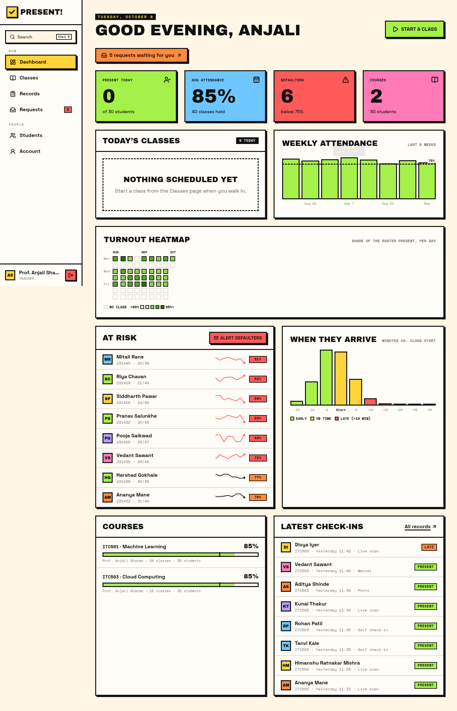
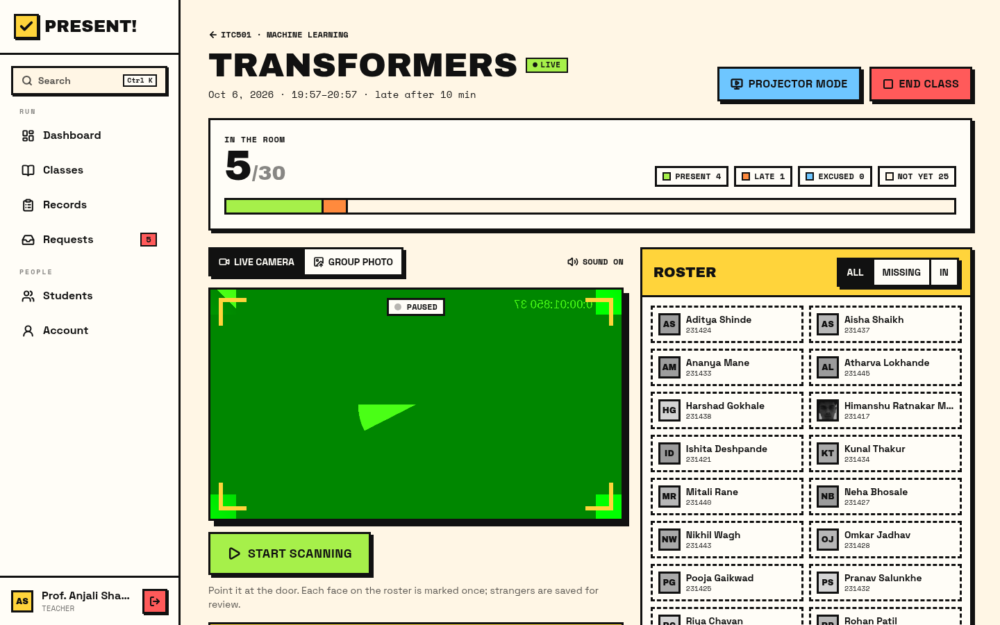
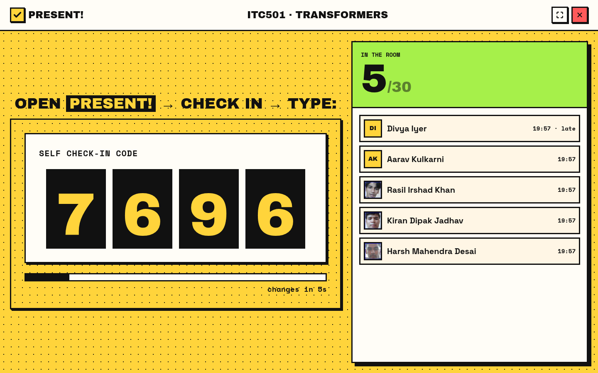
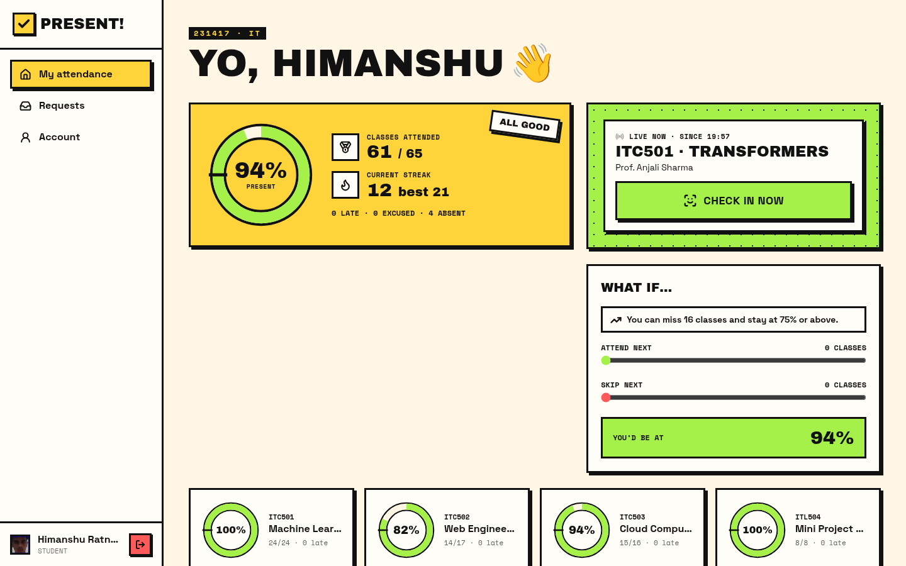
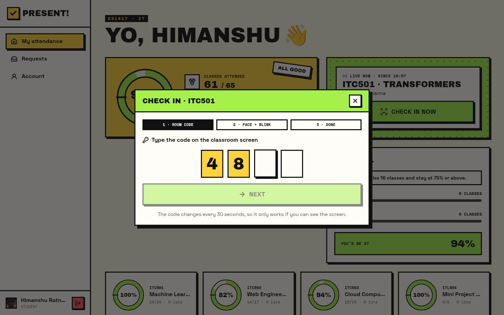
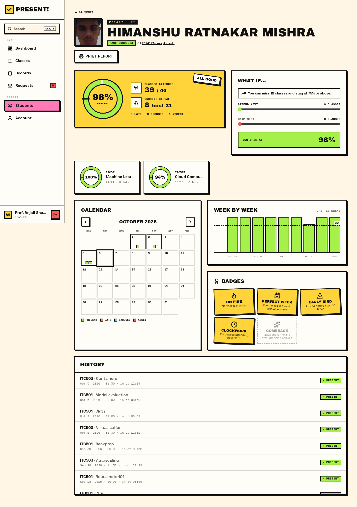
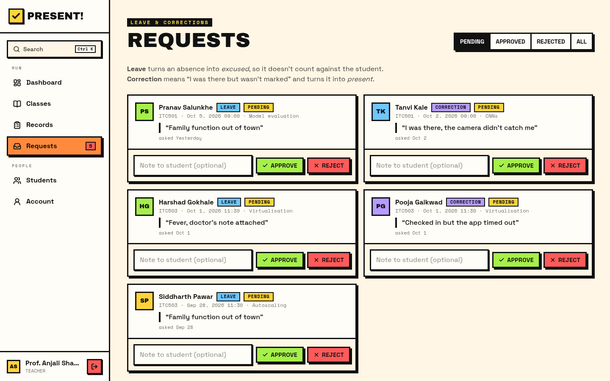
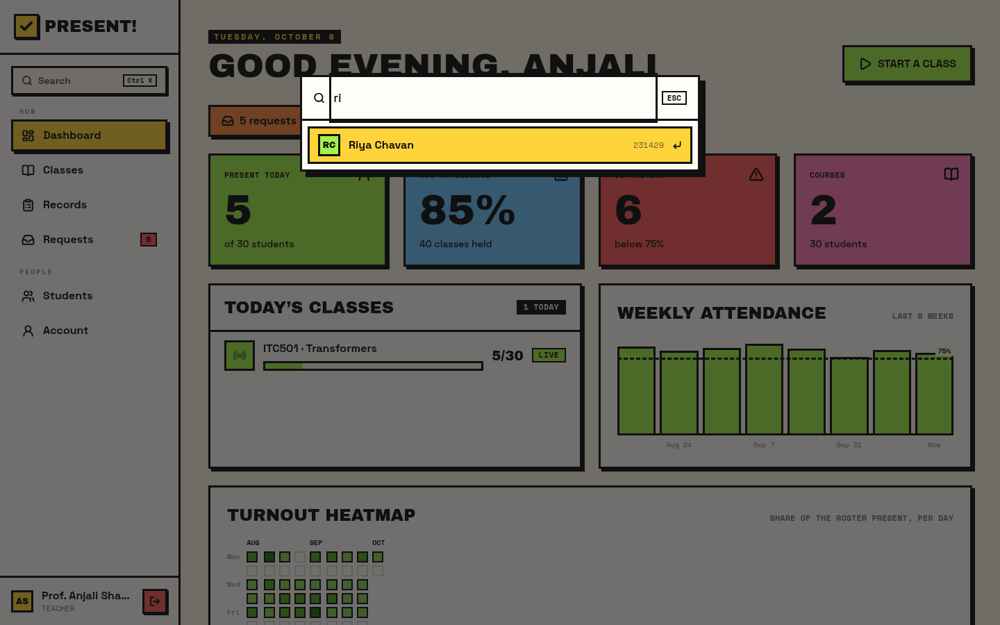
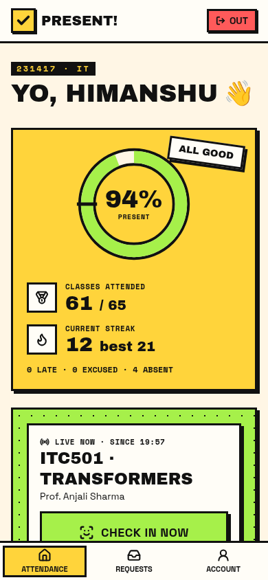

# Present! — Smart Attendance System

Face-recognition attendance for a college: teachers run a class, a webcam (or a group photo) marks everyone it recognises, and students can check themselves in, but only from inside the classroom and only with their real, live face.

**Flask + SQLite + `face_recognition` (dlib)** on the back end, **React 19 + TypeScript + Tailwind v4 + Motion** on the front end, in a neo-brutalist style.

> 📖 **[MAIN.md](MAIN.md)** explains how everything works: the architecture, data model, algorithms, security, and the full API.



---

## Features

### Taking attendance
- **Courses and class sessions.** Attendance is taken per lecture, not per day. A teacher presses *Start class*, picks a length and a late cut-off, and the class goes live.
- **Live kiosk scanner.** Point a webcam at the door. Every face on the course roster is marked once; boxes, names and match scores appear over the video, with a chime and a "Present!" card for each new arrival.
- **Group-photo upload.** Drop one class photo and everyone recognised in it is marked.
- **Present / Late / Excused / Absent.** Arriving after the late cut-off counts as *late*. Anyone still unmarked when the class ends counts as *absent*.
- **Live roster.** See who's in and who's missing, with real face photos and a progress bar. Tap anyone to change their mark.
- **Projector mode.** A full-screen view for the classroom: a giant rotating check-in code and a running list of who has arrived.

### Anti-proxy self check-in
Students can mark themselves present from their phone, but only if they pass three checks:
1. **Rotating classroom code.** A 4-digit code is shown on the projector and changes every 30 seconds (TOTP-style HMAC). You have to be in the room to see it. Wrong guesses are rate-limited.
2. **Blink liveness.** The phone captures a burst of frames and the server measures the *eye aspect ratio* in each one. No blink means it's a photo, so it's rejected.
3. **Face match.** The face must match *that student's* enrolled face in the two most open-eyed frames.

### For students
- Overall and per-course attendance rings, current and best streak, and a 10-week trend.
- **"What if" simulator.** Sliders show where you'd land if you attended or skipped the next *n* classes. Plus "you can miss *n*" / "attend the next *n* in a row" guidance.
- **Month calendar** coloured by status, and a full class history.
- **Badges:** On fire, Perfect week, Early bird, Clockwork, Comeback.
- **Leave and correction requests.** Ask for an absence to be excused, or say "I was there". The course teacher approves or rejects it with a note.

### For teachers and admins
- **Dashboard:** today's classes, a weekly trend, a GitHub-style **turnout heatmap**, an **arrival-time histogram** (early / on time / late), an **at-risk list with sparklines**, a course breakdown and the latest check-ins.
- **Requests inbox** with approve or reject, and a pending-count badge in the sidebar.
- **Records:** the whole register, absences included, filterable by course, date range, status and name. Fix any mark in place and export to CSV.
- **Attendance register CSV** per course (students × classes, P/L/E/A, totals, defaulter flag).
- **Student profile** with a printable report.
- **Defaulter email alerts.** Preview each email, then send through SMTP.
- **Ctrl/⌘ + K command palette** to jump to any student, course or page.

### Admin only
- **Roles:** admin, teacher, student. Teachers only see and run their own courses.
- Manage students (add, **bulk CSV import**, **guided face enrollment** with "turn left / right / smile" prompts, reset password, delete), teachers, courses and rosters.
- **Unknown-faces queue.** Faces the scanner couldn't match are saved, one per stranger per class. Label one and the model learns it, and the student is marked present for that class.
- **Audit log.** Every manual mark, request decision, deletion and enrollment, with who did it and when.

### Security and correctness
- Signed bearer tokens that are **revoked on password change**. **Forced password change** on first login, because starting passwords are roll numbers.
- **Login throttling** (5 failures per 5 minutes per IP).
- Time-zone-correct dates and times (`TIMEZONE`, default Asia/Kolkata), even on a UTC server.
- Deleting a student also deletes their face photos, so a retrain can't bring them back.
- An automatic **database migration** from the original one-row-per-day schema.
- A **23-test pytest suite** covering auth, roles, scanning, check-in, requests, CSV and migration.

## Screenshots

| | |
|---|---|
|  **Live class:** scanner, rotating code, roster |  **Projector mode** for the classroom |
|  **Student home** with a class live now |  **Self check-in:** room code, then blink |
|  **Student profile** (printable) |  **Requests inbox** |
|  **Ctrl + K** search |  **Mobile** |

## Run it locally

```bash
# 1. API (Python 3.12 recommended)
python -m venv server/.venv && source server/.venv/bin/activate
pip install dlib-bin && pip install --no-deps face-recognition   # avoids compiling dlib
pip install -r requirements-dev.txt
python -m server.app                     # http://localhost:10000

# 2. Frontend (another terminal)
cd web && npm install && npm run dev     # http://localhost:5173, proxies /api to :10000
```

The webcam only works on `localhost` or over HTTPS.

On first start the API creates `attendance.db` and fills it with **demo data**: two teachers, four courses, 30 students (the 5 real ones in `dataset/` plus 25 generated) and about 9 weeks of realistic history. Set `SEED_DEMO=0` for a clean install instead. If you already have an `attendance.db` from the old version, it is migrated in place, and (unless `SEED_DEMO=0`) the demo teachers, courses and history are added alongside your existing students.

To start the demo over: `python -m server.seed --reset`.

### Demo accounts

| Role | Username | Password |
|---|---|---|
| Admin | `admin` | `admin123` |
| Teacher | `t.sharma` (ITC501, ITC503) or `t.kulkarni` (ITC502, ITL504) | `teacher123` |
| Student | any roll number, e.g. `231417` | the roll number |

The login page has one-click buttons for these. Students and teachers that an admin creates must change their password on first sign-in.

### Try the anti-proxy check-in
1. Sign in as `t.sharma` → **Classes** → **Start class** on ITC501 → **Projector mode**.
2. In another browser (or a private window), sign in as `231417` → **Check in now**.
3. Type the code from the projector, press start, and blink when asked. (It only matches if your face is enrolled. Use **Students → Enroll face** as admin first.)

## Tests

```bash
python -m pytest              # backend: 23 API tests with a fake face recogniser
cd web && npm run lint && npm run build
```

## Configuration

| Var | Default | |
|---|---|---|
| `SECRET_KEY` | `dev-secret-change-me` | Signs login tokens. **Set it in production.** |
| `ADMIN_USERNAME` / `ADMIN_PASSWORD` | `admin` / `admin123` | Only used when the database is first created. |
| `DATA_DIR` | repo root | Where the database, face photos and model live. Point it at a persistent disk. |
| `DB_PATH` | `$DATA_DIR/attendance.db` | |
| `SEED_DEMO` | `1` | Fill a new database with demo data. |
| `TIMEZONE` | `Asia/Kolkata` | Wall-clock zone for dates and times. |
| `MATCH_TOLERANCE` | `0.5` | Face distance cut-off. Lower is stricter. |
| `DEFAULTER_THRESHOLD` | `75` | Minimum attendance %. |
| `LATE_AFTER_MINUTES` | `10` | Default late cut-off for new classes. |
| `LIVENESS` | `1` | Require a blink for self check-in. |
| `SMTP_HOST`, `SMTP_PORT`, `SMTP_USER`, `SMTP_PASSWORD`, `SMTP_FROM` | — | Defaulter alert emails. Without `SMTP_HOST`, alerts are preview-only. |
| `PORT` | `10000` | |

## Deploy

```bash
./render-build.sh                         # installs Python deps and builds web/dist
SECRET_KEY=change-me gunicorn -w 1 --threads 8 -b 0.0.0.0:$PORT server.app:app
```

Flask serves the built frontend from `web/dist`. Keep **one** worker: the face model lives in memory and enrolling updates it in place. `render.yaml` and `vercel.json` (frontend only, proxying `/api` to Render) are included.

> ⚠️ Render's free plan has no persistent disk, so the database and new enrollments reset on every deploy. On a paid plan, mount a disk and set `DATA_DIR` (see `render.yaml`).

## Project layout

```
server/            Flask API
  __init__.py      app factory
  config.py        settings (env vars)
  db.py            schema, v1→v2 migration, shared writes, audit
  auth.py          tokens, roles, login throttling
  recognizer.py    face matching, blink liveness, enrollment
  marking.py       marking attendance, scanning, unknown-face capture
  stats.py         attendance maths, dashboard aggregates, badges
  codes.py         rotating check-in codes
  seed.py          demo data
  routes/          auth, students, courses, sessions, records, requests, me, admin
tests/             pytest suite
web/src/
  pages/staff/     Dashboard, Classes, CourseDetail, LiveClass, Projector, Records,
                   Requests, Students, StudentProfile, Teachers, UnknownFaces, Audit
  pages/student/   Home, CheckIn, MyRequests, RequestModal
  components/      ui kit, charts, report, Shell, CommandPalette, Viewfinder, …
dataset/           face photos, one folder per roll number
trained_model/     model.pkl (face encodings)
```

## Privacy note

Face photos and encodings are biometric data. Collect them only with consent, keep the repository private if it holds real students' faces, and delete a student's data (Students → delete) when they leave.
